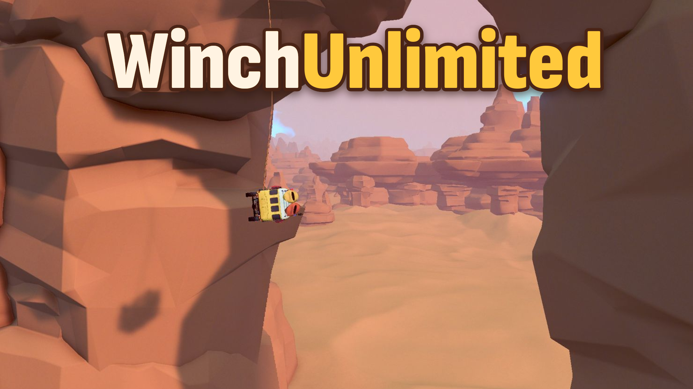

# WinchUnlimited



Download: [Nexus Mods](https://www.nexusmods.com/overthehill/mods/117) (mod 117, file 340).

A [MelonLoader](https://github.com/LavaGang/MelonLoader) mod for Over the Hill that removes the winch's limits.

- Reel in all the way, with no stalling or slipping under heavy load.
- Pay the rope out up to 9000 m once attached. You still attach using the game's normal range.
- Optional faster reel.

Works with [RealisticWinch](https://github.com/Jeffrharr/RealisticWinch). Requires [JoofOTHFramework](https://github.com/Jeffrharr/JoofOTHFramework), the shared Joof library.

## Install

1. Install MelonLoader 0.7.x into Over the Hill. Start the game once so it sets itself up, then quit.
2. Install [JoofOTHFramework](https://github.com/Jeffrharr/JoofOTHFramework) into the game's `UserLibs/` folder.
3. Put `WinchUnlimited.dll` into the game's `Mods/` folder.

Linux / Steam Deck (native build): MelonLoader needs the [.NET 6 runtime](https://dotnet.microsoft.com/download/dotnet/6.0), for example extracted to `~/.local/share/dotnet6`. Steam launch options:

```
LD_LIBRARY_PATH="$PWD" LD_PRELOAD="MelonLoader.Bootstrap.so" DOTNET_ROOT="$HOME/.local/share/dotnet6" %command%
```

## Settings

`UserData/MelonPreferences.cfg`, created on first launch, under `[WinchUnlimited]`:

| Setting | Default | |
|---|---|---|
| `Enabled` | `true` | Unlimited winch retraction |
| `MinRopeLength` | `0.3` | Shortest the rope reels in to, in metres. Don't set 0: the physics can explode |
| `NoStall` | `true` | The winch doesn't stall or slip under heavy load |
| `ReelSpeedMultiplier` | `1` | Reel speed multiplier (1 = game default) |
| `MaxExtension` | `9000` | How far (m) the rope pays out once attached (0 = game default) |

Multiplayer: everyone should install it. The host runs the physics, so the host needs it. Each player's settings are sent to the host, which applies them to that player's winch.

## Building

The project builds against the DLLs in your game folder, so it needs:

- the .NET SDK (6.0 or newer)
- MelonLoader installed and run once, so `MelonLoader/Il2CppAssemblies/` exists
- `JoofOTHFramework.dll` in the game's `UserLibs/`

```
dotnet build
```

`GameDir` defaults to the Steam path on Linux. Override it with `-p:GameDir="/path/to/over the hill"`. The build copies the DLL into the game's `Mods/` folder.

## License

[MIT](LICENSE). Not affiliated with Funselektor.
